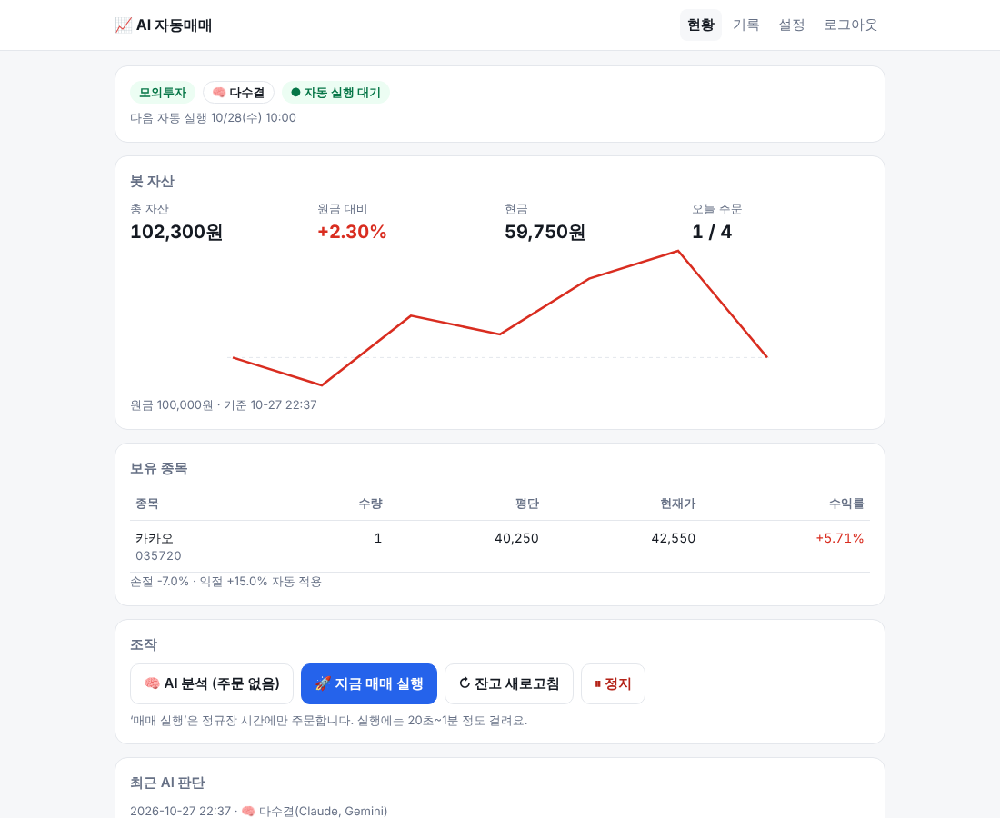
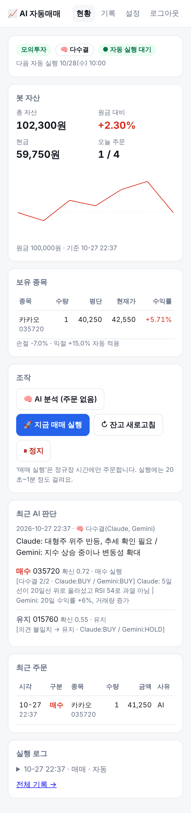
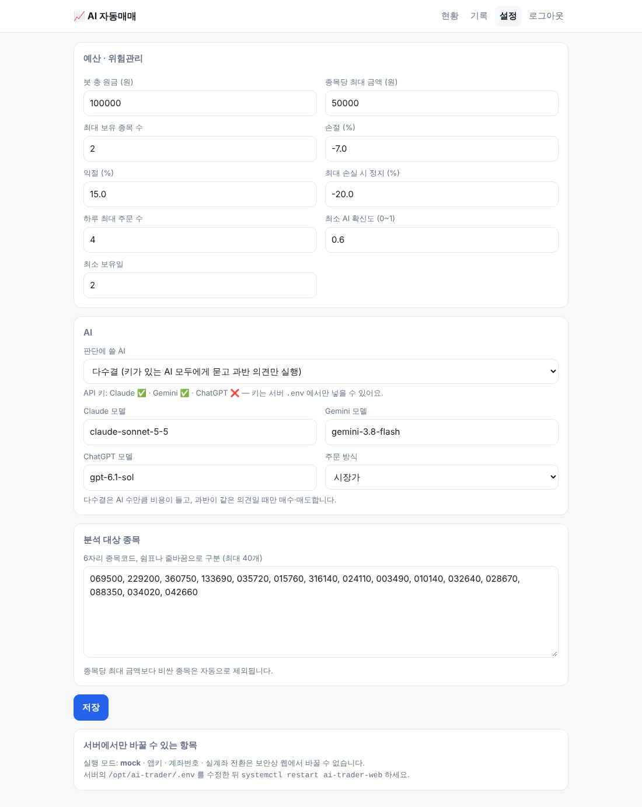

# ai-trader

**AI가 하루 1~2번 국내 주식을 분석해서, 정해 둔 규칙 안에서만 사고파는 소액 자동매매 프로그램**

- 증권사: **NH투자증권 나무 Open API** (기본) · 한국투자증권 KIS Open API
- AI: **Claude · Gemini · ChatGPT** 중 선택, 또는 여러 AI **다수결**
- 운영: 리눅스(Proxmox LXC 등) + systemd 타이머, **웹 관리 화면**(PC·휴대폰)

> ⚠️ 투자 손실 책임은 사용자에게 있습니다. 반드시 **드라이런 → 모의투자**로 충분히 검증한 뒤, 잃어도 괜찮은 금액으로만 실계좌에 쓰세요.

<p align="center">
  
  
</p>
<p align="center"><sub>웹 관리 화면 — 테스트 데이터</sub></p>

---

## 어떻게 동작하나요

```
 [증권사 API] 시세·일봉·잔고
        │
        ▼
 지표 계산 (이동평균·RSI·수익률·변동성·PER/PBR·52주 위치·경고종목)
        │
        ├──► ① 손절·익절 규칙 ── AI보다 먼저, 무조건 실행
        │
        ▼
 [AI] 매수 / 매도 / 유지 제안 + 확신도 + 근거
   Claude │ Gemini │ ChatGPT │ 다수결
        │
        ▼
 ② 위험관리 필터 ── 예산·종목당 한도·보유 수·확신도·최소 보유일·하루 주문 수·경고종목
        │
        ▼
 [증권사 API] 주문 ──► 매매일지(SQLite) ──► 웹 화면
```

**AI는 제안만 합니다.** 실제로 주문을 낼지, 몇 주를 살지는 코드의 규칙이 결정합니다.
AI가 이상한 값을 내거나 응답에 실패하면 그 회차는 매매하지 않습니다.

## 주요 기능

| 기능 | 설명 |
|---|---|
| 3단계 실행 모드 | `dry`(분석만, 주문 없음) → `mock`(모의투자) → `live`(실계좌) |
| AI 선택 | Claude / Gemini / ChatGPT / 다수결 — 웹에서 바로 전환 |
| 다수결 | 키가 있는 AI 전부에게 같은 데이터를 주고, **과반이 같은 의견일 때만** 매수·매도 |
| 봇 전용 장부 | 계좌에 돈이 더 있어도 설정한 예산까지만 사용, 봇이 산 종목만 봇이 매도 |
| 자동 재시도 | AI 서버 혼잡(503)·한도(429) 시 10·30·60초 간격으로 재시도 |
| 웹 관리 화면 | 현황·자산 추이·AI 판단 근거·주문 내역·설정 변경·정지/재개·수동 실행 |
| 휴장일 처리 | 증권사 장상태 값, 없으면 오늘 일봉 유무로 판단해 자동으로 건너뜀 |

## 안전장치

| 장치 | 기본값 | 설명 |
|---|---|---|
| 봇 예산 | 10만원 | 봇 전용 장부로 관리 |
| 종목당 한도 | 5만원 | 이보다 비싼 종목은 매수 후보에서 제외 |
| 최대 보유 | 2종목 | |
| 손절 / 익절 | -7% / +15% | AI 판단과 무관하게 먼저 실행 |
| 최대 손실 | -20% | 도달하면 매매 정지, 직접 `resume` 해야 재개 |
| 하루 주문 | 4회 | |
| 최소 확신도 | 0.6 | 미만이면 무시 |
| 최소 보유일 | 2일 | 잦은 교체로 수수료가 새는 것 방지 (손절·익절은 예외) |
| 경고 종목 | 매수 금지 | 투자유의·주의·경고·위험·단기과열·정리매매 |
| 내 다른 주식 | 건드리지 않음 | 봇이 산 종목만 매도 |
| 모드·서버 불일치 | 실행 거부 | 예) `mock`인데 실전 서버 주소면 중단 |
| 실계좌 | 삼중 확인 | `TRADING_MODE=live` + 실전 서버 주소 + `I_UNDERSTAND_REAL_MONEY=yes` |
| 동시 실행 | 잠금 | 타이머·웹·명령줄 실행이 겹치지 않음 |
| 킬스위치 | `run.py stop` / 웹 ‘정지’ | |

모든 수치는 웹 설정 화면이나 `config.toml`에서 바꿀 수 있습니다. `config.toml`은 처음 실행할 때 `config.example.toml`을 복사해 자동으로 만들어지며, git에는 올라가지 않아서 업데이트해도 설정이 유지됩니다.

---

## 빠른 시작

### 1. 준비물

| 항목 | 어디서 | 비고 |
|---|---|---|
| NH 나무 Open API 앱키 | [nhplug.com](https://www.nhplug.com/intro) | 앱키·시크릿 발급 + **모의투자 신청** |
| AI API 키 (하나 이상) | Claude [console.anthropic.com](https://console.anthropic.com) · Gemini [aistudio.google.com](https://aistudio.google.com) · ChatGPT [platform.openai.com](https://platform.openai.com) | 구독(Claude Pro, ChatGPT Plus)과 **API 결제는 별도** |
| 리눅스 + Python 3.11 이상 | Proxmox LXC(Ubuntu 24.04 / Debian 12) 추천 | CPU 1코어, RAM 512MB면 충분 |

### 2. 설치

```bash
sudo apt install -y git python3-venv
sudo git clone https://github.com/kwon2288/ai-trader /opt/ai-trader
cd /opt/ai-trader
python3 -m venv .venv
.venv/bin/pip install -r requirements.txt
cp .env.example .env && chmod 600 .env
nano .env
```

`.env`에 최소한 아래 값을 넣습니다.

```ini
TRADING_MODE=dry                 # 처음엔 반드시 dry
NHPLUG_APP_KEY=...
NHPLUG_APP_SECRET=...
NHPLUG_BASE_URL=https://moapi.nhplug.com:8443   # 모의투자 서버
GEMINI_API_KEY=...               # 쓸 AI 키 (하나 이상)
WEB_PASSWORD=8자이상비밀번호
```

> LXC에서 한글이 깨지면: `apt install -y locales && locale-gen ko_KR.UTF-8 en_US.UTF-8 && update-locale LANG=en_US.UTF-8` 후 재접속

### 3. 단계별 확인 (순서대로)

```bash
.venv/bin/python run.py check      # ① 증권사 연결·계좌·잔고·시세 확인
.venv/bin/python run.py accounts   #    (계좌가 여러 개면) 국내주식 계좌 찾기 → .env 의 NHPLUG_ACCOUNT
.venv/bin/python run.py aitest     # ② AI 키·모델명 확인
.venv/bin/python run.py analyze    # ③ AI 판단만 보기 (주문 없음, 장외 시간에도 가능)
.venv/bin/python run.py trade      # ④ dry 모드로 전체 흐름 확인 (주문 안 냄)
```

①~④가 모두 괜찮으면 `.env`에서 `TRADING_MODE=mock`으로 바꿔 모의투자 주문을 시작합니다.

**권장 일정:** dry 며칠 → mock 최소 4주 → 결과가 납득될 때만 live

### 4. 자동 실행 (평일 10:00, 14:30 KST)

```bash
sudo cp deploy/ai-trader.service deploy/ai-trader.timer /etc/systemd/system/
sudo systemctl daemon-reload
sudo systemctl enable --now ai-trader.timer
systemctl list-timers ai-trader.timer      # 다음 실행 시각
journalctl -u ai-trader -n 50              # 최근 실행 결과
```

실행 시각은 `deploy/ai-trader.timer`에서 바꿀 수 있습니다. 바꿨다면 `web/app.py`의 `SCHEDULE`도 맞춰 주세요(웹의 ‘다음 실행’ 표시용).

### 5. 웹 관리 화면

```bash
sudo cp deploy/ai-trader-web.service /etc/systemd/system/
sudo systemctl daemon-reload
sudo systemctl enable --now ai-trader-web
```

브라우저에서 `http://<서버 IP>:8080` 접속 → `WEB_PASSWORD`로 로그인.

| 화면 | 할 수 있는 것 |
|---|---|
| 현황 | 봇 자산·수익률·자산 추이, 보유 종목, 최근 AI 판단과 근거, 지금 분석/매매 실행, 잔고 새로고침, 정지/재개 |
| 기록 | 주문 내역, AI 판단 기록, 실행 로그(자동·웹·명령줄 구분) |
| 설정 | AI 선택·모델(드롭다운, 목록에 없으면 '직접 입력'), 예산·손절/익절·확신도·최소 보유일·종목 목록 (다음 실행부터 적용) |

<p align="center"></p>

- 실행 모드, 앱키, AI 키, 실계좌 전환은 보안상 **웹에서 바꿀 수 없습니다.** 서버의 `.env`를 고친 뒤 `sudo systemctl restart ai-trader-web` 하세요.
- `.env`에 `AI_PROVIDER`를 넣으면 웹 설정보다 우선합니다. 웹에서 관리하려면 넣지 마세요.
- **공유기 포트포워딩으로 인터넷에 직접 열지 마세요.** 집 밖에서 쓰려면 Tailscale이나 Cloudflare Tunnel + Access 뒤에 두세요.

---

## 명령어

| 명령 | 설명 |
|---|---|
| `run.py check` | 증권사 연결·계좌·잔고·시세·AI 키 상태 확인 |
| `run.py accounts` | (NH) 계좌 목록과 국내주식 사용 가능 여부 |
| `run.py aitest` | 키가 있는 AI마다 짧은 테스트 질의 (시세·주문 없음) |
| `run.py analyze` | AI 판단만 보기 — 주문 없음, 장외 시간에도 가능 |
| `run.py trade` | 매매 사이클 1회 — `TRADING_MODE`에 따라 동작, 정규장에만 주문 |
| `run.py report` | 최근 30일 주문 내역 |
| `run.py stop` / `resume` | 킬스위치 켜기 / 정지 해제(손실 한도 정지 포함) |

## 설정

### AI 선택 (`config.toml` `[ai]` 또는 웹 설정)

| provider | 설명 | 필요한 키 | 기본 모델 |
|---|---|---|---|
| `claude` | Anthropic Claude | `ANTHROPIC_API_KEY` | `claude-sonnet-5-5` |
| `gemini` | Google Gemini | `GEMINI_API_KEY` | `gemini-3.8-flash` |
| `openai` | OpenAI ChatGPT | `OPENAI_API_KEY` | `gpt-6.1-sol` |
| `consensus` | 키가 있는 AI 전부에게 묻고 다수결 | 2개 이상 | — |

- 모든 AI는 같은 데이터와 같은 지침을 받고, 같은 JSON 형식으로 답합니다. 형식이 틀린 값은 코드가 버립니다.
- **다수결 규칙:** 응답한 AI의 과반이 같은 행동(매수/매도)일 때만 채택하고, 아니면 유지합니다. 확신도는 찬성한 AI의 평균, 금액은 찬성한 AI 중 가장 보수적인 값을 씁니다. AI 하나가 실패해도 나머지로 판단하지만, 응답이 1개만 남으면 그 회차는 매매하지 않습니다.
- 모델명은 각 회사 사정으로 바뀔 수 있습니다. `run.py aitest`에서 오류가 나면 웹 설정에서 모델명을 바꾸세요.

### 주요 `.env` 항목

| 변수 | 설명 |
|---|---|
| `TRADING_MODE` | `dry` / `mock` / `live` |
| `BROKER` | `nh`(기본) / `kis` |
| `NHPLUG_APP_KEY`, `NHPLUG_APP_SECRET` | NH 나무 앱키 |
| `NHPLUG_BASE_URL` | 모의 `https://moapi.nhplug.com:8443` / 실전 `https://api.nhplug.com:8443` |
| `NHPLUG_ACCOUNT` | 계좌가 여러 개일 때 국내주식 계좌번호 |
| `ANTHROPIC_API_KEY`, `GEMINI_API_KEY`, `OPENAI_API_KEY` | AI 키 (쓸 것만) |
| `I_UNDERSTAND_REAL_MONEY` | 실계좌 실행 시 `yes` |
| `WEB_PASSWORD`, `WEB_PORT` | 웹 관리 화면 |

전체 목록은 [`.env.example`](.env.example)을 보세요.

### NH 나무증권 참고

- 앱키 하나로 모의투자와 실계좌를 모두 씁니다. 서버 주소(`moapi` / `api`)로 구분합니다.
- **NH 모의투자 서버는 시세 API를 제공하지 않습니다.** 그래서 모의투자 중에도 *시세만* 실전 서버에서 받아옵니다. 시세는 계좌와 무관한 공개 데이터이고, **잔고·주문은 항상 모의 서버로만** 갑니다(테스트로 검증).
- 계좌 목록 API에 계좌 종류가 없어서, 계좌가 여러 개면 국내주식 잔고 조회가 되는 계좌를 자동으로 고릅니다. 그래도 여러 개면 `NHPLUG_ACCOUNT`로 지정하세요.

### 한국투자증권으로 쓰려면

`.env`에 `BROKER=kis`와 `KIS_SERVER`, `KIS_APP_KEY`, `KIS_APP_SECRET`, `KIS_ACCOUNT`(예: `12345678-01`)를 넣습니다. KIS는 모의투자와 실전 앱키가 따로입니다.

---

## 업데이트

```bash
cd /opt/ai-trader
bash deploy/update.sh      # git pull → 패키지 설치 → 웹 화면 재시작
```

`.env`, `config.toml`, `data/`는 git에 없으므로 업데이트해도 그대로 유지됩니다.
자동 실행(타이머)은 매번 새로 시작하므로 따로 재시작할 필요가 없습니다.

## 실계좌로 전환

`.env`에서 세 줄을 바꿉니다.

```ini
TRADING_MODE=live
NHPLUG_BASE_URL=https://api.nhplug.com:8443
I_UNDERSTAND_REAL_MONEY=yes
```

모의투자 장부와 실계좌 장부는 따로 관리됩니다(`bot_cash_mock` / `bot_cash_live`). 실계좌에서도 봇은 `config.toml`의 예산까지만 씁니다.

## 프로젝트 구조

```
ai-trader/
├── run.py                 # 명령줄 진입점
├── config.example.toml    # 전략 설정 예시 → 첫 실행 시 config.toml 로 복사 (git 제외)
├── .env.example           # 자격증명·모드 템플릿
├── trader/
│   ├── bot.py             # 한 사이클: 데이터 → 손절/익절 → AI → 위험관리 → 주문
│   ├── analyst.py         # Claude/Gemini/ChatGPT 분석기, 다수결, 재시도
│   ├── broker.py          # 공통 데이터 구조 + NH 나무증권 래퍼
│   ├── kis.py             # 한국투자증권 래퍼
│   ├── indicators.py      # 이동평균·RSI·수익률·변동성 (순수 파이썬)
│   ├── journal.py         # 매매일지·봇 장부 (SQLite)
│   ├── runner.py          # 실행 잠금·증권사 선택 (명령줄·타이머·웹 공용)
│   └── config.py
├── web/                   # Flask 웹 관리 화면
├── deploy/                # systemd 서비스·타이머, update.sh
├── tests/                 # 오프라인 테스트 (네트워크·키 불필요)
└── data/                  # 실행 시 생성: journal.db, 로그, 토큰 캐시 (git 제외)
```

## 테스트

네트워크나 API 키 없이 가짜 증권사·가짜 AI 응답으로 규칙을 검증합니다.

```bash
.venv/bin/python tests/test_bot.py       # 위험관리 규칙 (예산·한도·손절·보유일·킬스위치 등)
.venv/bin/python tests/test_analyst.py   # AI 응답 파싱·재시도·다수결
.venv/bin/python tests/test_nh.py        # NH: 시세만 실전 서버, 주문·잔고는 모의 서버
.venv/bin/python tests/test_kis.py       # KIS: 파싱·tr_id·안전장치
```

## 꼭 알아둘 점

- 매도 시 거래세, 매매마다 수수료가 붙습니다. 소액으로 잦은 매매를 하면 그것만으로 손실이 납니다.
- AI는 이 프로그램이 넘겨주는 지표만 보고 판단합니다. **뉴스·공시는 보지 않습니다.**
- 봇 장부의 현금은 주문 시점 호가 기준 추정치라, 실제 체결가·수수료와 약간 다를 수 있습니다.
- AI 호출 비용이 듭니다. 실행할 때마다 토큰 사용량이 출력되니 며칠 돌려보고 가늠하세요.
- 이 프로그램은 수익을 보장하지 않으며, 투자 판단과 결과의 책임은 사용자에게 있습니다.
