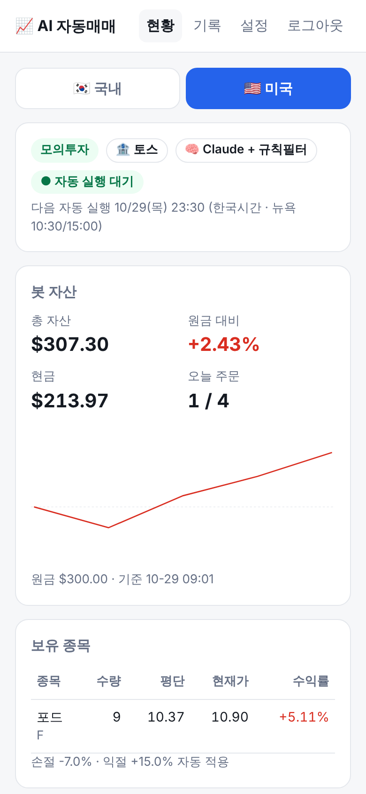

# ai-trader

**AI가 하루 1~2번 국내 주식을 분석해서, 정해 둔 규칙 안에서만 사고파는 소액 자동매매 프로그램**

- 시장: **국내(KRX)** + **미국** — 예산·장부·손실한도를 시장별로 따로
- 증권사: **NH투자증권 나무** (기본, 국내·미국) · **토스증권** (국내·미국) · 한국투자증권 (국내)
- AI: **Claude · Gemini · ChatGPT** 중 선택, 여러 AI **다수결**, 또는 **규칙만**(AI 없음)
- **하이브리드:** 규칙이 먼저 신호를 찾고 신호 난 종목만 AI가 확인 → 신호 없는 날은 AI 호출 0회
- 운영: 리눅스(Proxmox LXC 등) + systemd 타이머, **웹 관리 화면**(PC·휴대폰)

> ⚠️ 투자 손실 책임은 사용자에게 있습니다. 반드시 **드라이런 → 모의투자**로 충분히 검증한 뒤, 잃어도 괜찮은 금액으로만 실계좌에 쓰세요.

<p align="center">
  
  
</p>
<p align="center"><sub>웹 관리 화면 — 테스트 데이터</sub></p>

---

## 어떻게 동작하나요

```
 [증권사 API] 시세·일봉·잔고
        │
        ▼
 지표 계산 (이동평균·RSI·수익률·변동성·PER/PBR·52주 위치·경고종목)
        │
        ├──► ① 손절·익절 규칙 ── AI보다 먼저, 무조건 실행
        │
        ▼
 규칙 신호 (추세·과열) ── 하이브리드: 신호 없으면 여기서 끝 (AI 호출 생략)
        │ 신호 난 종목만
        ▼
 [AI] 매수 / 매도 / 유지 제안 + 확신도 + 근거
   Claude │ Gemini │ ChatGPT │ 다수결
        │
        ▼
 ② 위험관리 필터 ── 예산·종목당 한도·보유 수·확신도·최소 보유일·하루 주문 수·경고종목
        │
        ▼
 [증권사 API] 주문 ──► 매매일지(SQLite) ──► 웹 화면
```

**AI는 제안만 합니다.** 실제로 주문을 낼지, 몇 주를 살지는 코드의 규칙이 결정합니다.
AI가 이상한 값을 내거나 응답에 실패하면 그 회차는 매매하지 않습니다.

## 주요 기능

| 기능 | 설명 |
|---|---|
| 3단계 실행 모드 | `dry`(분석만, 주문 없음) → `mock`(모의투자) → `live`(실계좌) |
| AI 선택 | Claude / Gemini / ChatGPT / 다수결 / 규칙만 — 웹에서 바로 전환 |
| 하이브리드(토큰 절약) | 규칙이 신호를 찾은 종목만 AI에게 보내고, 신호가 없으면 AI를 부르지 않음 |
| 다수결 | 키가 있는 AI 전부에게 같은 데이터를 주고, **과반이 같은 의견일 때만** 매수·매도 |
| 봇 전용 장부 | 계좌에 돈이 더 있어도 설정한 예산까지만 사용, 봇이 산 종목만 봇이 매도 |
| 자동 재시도 | AI 서버 혼잡(503)·한도(429) 시 10·30·60초 간격으로 재시도 |
| 웹 관리 화면 | 현황·자산 추이·AI 판단 근거·주문 내역·설정 변경·정지/재개·수동 실행 |
| 자동 종목 선정 | 핵심 종목(직접 지정)은 고정, 나머지 자리는 매일 전 종목 조건 검색 → 전일 거래대금 상위로 채움 |
| 미국 주식 | 달러 예산·장부 따로, 뉴욕 시간 기준 자동 실행, NH는 원화로 바로 주문(환전 불필요) |
| 휴장일 처리 | 증권사 장상태 값, 없으면 오늘 일봉 유무로 판단해 자동으로 건너뜀 |

## 안전장치

| 장치 | 기본값 | 설명 |
|---|---|---|
| 봇 예산 | 10만원 | 봇이 동시에 투자할 수 있는 최대 금액. 실제 매수는 min(예산 − 투자 중, 계좌 주문가능 현금). 수익은 재투자 안 함 |
| 종목당 한도 | 5만원 | 이보다 비싼 종목은 매수 후보에서 제외 |
| 최대 보유 | 2종목 | |
| 손절 / 익절 | -7% / +15% | AI 판단과 무관하게 먼저 실행. 손절은 시장가·하루 주문 한도와 무관 |
| 장중 감시 | 15분마다 | 정기 실행 사이에도 AI 없이 손절·익절만 확인 (토큰 0, 웹에서 간격 변경·끄기) |
| 체결 확인 | 매 실행 | 실제 체결된 수량·가격만 봇 장부에 반영, 지난 실행의 미체결 주문은 취소 |
| 실행 누락 감시 | 켜짐 | 정해진 시각에 실행 기록이 없으면 알림. 서버가 통째로 꺼지는 경우는 헬스체크 주소(HEALTHCHECK_URL)로 |
| 백업 | 하루 1번 | 매매 기록·설정 zip, 보관 기간·추가 저장 위치(NAS) 설정, 웹에서 내려받기 |
| 최대 손실 | -20% | 도달하면 매매 정지, 직접 `resume` 해야 재개 |
| 하루 주문 | 4회 | |
| 최소 확신도 | 0.6 | 미만이면 무시 |
| 최소 보유일 | 2일 | 잦은 교체로 수수료가 새는 것 방지 (손절·익절은 예외) |
| 경고 종목 | 매수 금지 | 투자유의·주의·경고·위험·단기과열·정리매매 |
| 내 다른 주식 | 건드리지 않음 | 봇이 산 종목·수량만 매도. 내가 이미 가진 종목은 봇이 사지 않음 (섞이지 않게) |
| 같은 종목을 나중에 내가 더 산 경우 | 봇 몫만 | 봇이 산 수량만 관리·매도, 손익도 봇 평단 기준 |
| 계좌 현금 | 예산까지만 | 계좌에 돈이 더 있어도 예산 안에서만, 계좌에 돈이 적으면 있는 만큼만 |
| 실계좌 | 확인 절차 | 웹: 비밀번호 재입력 + 확인 문구 + 실제 연결 확인 / `.env`: `TRADING_MODE=live` + `I_UNDERSTAND_REAL_MONEY=yes` |
| 동시 실행 | 잠금 | 타이머·웹·명령줄 실행이 겹치지 않음 |
| 킬스위치 | `run.py stop` / 웹 ‘정지’ | |

모든 수치는 웹 설정 화면이나 `config.toml`에서 바꿀 수 있습니다. `config.toml`은 처음 실행할 때 `config.example.toml`을 복사해 자동으로 만들어지며, git에는 올라가지 않아서 업데이트해도 설정이 유지됩니다.

---

## 빠른 시작

### 1. 준비물

| 항목 | 어디서 | 비고 |
|---|---|---|
| NH 나무 Open API 앱키 | [nhplug.com](https://www.nhplug.com/intro) | 앱키·시크릿 발급 + **모의투자 신청** |
| AI API 키 (하나 이상) | Claude [console.anthropic.com](https://console.anthropic.com) · Gemini [aistudio.google.com](https://aistudio.google.com) · ChatGPT [platform.openai.com](https://platform.openai.com) | 구독(Claude Pro, ChatGPT Plus)과 **API 결제는 별도** |
| 리눅스 + Python 3.11 이상 | Proxmox LXC(Ubuntu 24.04 / Debian 12) 추천 | CPU 1코어, RAM 512MB면 충분 |

### 2. 설치

```bash
sudo apt install -y git python3-venv
sudo git clone https://github.com/kwon2288/ai-trader /opt/ai-trader
cd /opt/ai-trader
python3 -m venv .venv
.venv/bin/pip install -r requirements.txt
.venv/bin/python run.py passwd     # 웹 비밀번호 정하기 (.env 를 자동으로 만듦)
```

나머지는 **웹 화면(5단계)을 띄운 뒤 설정 → 연결 정보** 에서 넣으면 됩니다.

| 항목 | 넣을 곳 |
|---|---|
| NH 앱키 · 앱 시크릿 (필수) | 설정 → 연결 정보 → NH 나무증권 |
| AI 키 (하나 이상, 무료는 Gemini) | 설정 → 연결 정보 → AI API 키 |
| 실행 모드 (처음엔 드라이런) | 설정 → 실행 모드 |

웹 없이 하려면 `nano .env` 로 직접 넣어도 됩니다 (`NHPLUG_APP_KEY`, `NHPLUG_APP_SECRET`, `GEMINI_API_KEY`, `TRADING_MODE=dry`).

> LXC에서 한글이 깨지면: `apt install -y locales && locale-gen ko_KR.UTF-8 en_US.UTF-8 && update-locale LANG=en_US.UTF-8` 후 재접속

### 3. 단계별 확인 (순서대로)

```bash
.venv/bin/python run.py check      # ① 증권사 연결·계좌·잔고·시세 확인
.venv/bin/python run.py accounts   #    (계좌가 여러 개면) 국내주식 계좌 찾기 → .env 의 NHPLUG_ACCOUNT
.venv/bin/python run.py aitest     # ② AI 키·모델명 확인
.venv/bin/python run.py analyze    # ③ AI 판단만 보기 (주문 없음, 장외 시간에도 가능)
.venv/bin/python run.py trade      # ④ dry 모드로 전체 흐름 확인 (주문 안 냄)
```

①~④가 모두 괜찮으면 웹 **설정 → 실행 모드** 에서 모의투자로 바꿔 주문을 시작합니다.

**권장 일정:** dry 며칠 → mock 최소 4주 → 결과가 납득될 때만 live

### 4. 자동 실행 (기본 평일 10:00, 14:30 KST — 웹 설정 → 자동 실행 시각에서 변경)

```bash
sudo cp deploy/ai-trader.service deploy/ai-trader.timer /etc/systemd/system/
sudo systemctl daemon-reload
sudo systemctl enable --now ai-trader.timer
systemctl list-timers ai-trader.timer      # 다음 실행 시각
journalctl -u ai-trader -n 50              # 최근 실행 결과
```

실행 시각은 웹 **설정 → 자동 실행 시각**에서 바꾸면 타이머에 바로 적용됩니다(하루 1~6번).

### 5. 웹 관리 화면

```bash
sudo cp deploy/ai-trader-web.service /etc/systemd/system/
sudo systemctl daemon-reload
sudo systemctl enable --now ai-trader-web
```

브라우저에서 `http://<서버 IP>:8080` 접속 → `run.py passwd` 로 정한 비밀번호로 로그인.

| 화면 | 할 수 있는 것 |
|---|---|
| 현황 | 봇 자산·수익률·자산 추이, 봇 보유 종목, **내 계좌 전체 보유 종목(직접 산 것 포함)**, 오늘의 분석 대상(자동 선정 목록), 최근 AI 판단과 근거, 지금 분석/매매 실행, 종목 다시 찾기, 잔고 새로고침, 정지/재개 |
| 손익 | 기간별(오늘~전체·기간 지정) 실현 손익, 승률, 일별·월별 그래프, 종목별 손익, 매도 내역 |
| 기록 | 주문 내역, AI 판단 기록, 실행 로그(자동·웹·명령줄 구분) |
| 설정 | AI 선택·모델(드롭다운, 목록에 없으면 '직접 입력'), 예산·손절/익절·확신도·최소 보유일·종목 목록, 미국 주식, **실행 모드**, **연결 정보(앱키·계좌·AI 키·웹 비밀번호)** (다음 실행부터 적용) |

<p align="center"></p>

- **AI 사용량**: 설정 → AI → ‘📊 AI 사용량’에서 모델별 토큰·비용, $5 충전 시 사용 기간, 충전 잔액 추정.
- **앱처럼 쓰기**: 아이폰 Safari 공유 → ‘홈 화면에 추가’ (전용 아이콘, 전체 화면). 안드로이드는 크롬 메뉴 → ‘앱 설치’.
- **알림**: 설정 → 알림에서 텔레그램(봇 토큰 + ‘채팅 ID 찾기’) 또는 카카오톡(‘나와의 채팅’, 카카오 개발자 앱 필요)을 연결하고 받을 종류를 고르세요.
- **패스키 로그인**: 설정 → 보안 → ‘이 기기에 패스키 등록’ (https 도메인 접속에서만). 아이폰은 Face ID로 확인.
- **연결 정보** 는 저장할 때 웹 비밀번호를 다시 묻고, 넣은 값은 화면에 다시 보여 주지 않습니다(앱키는 끝 4자리만).
  빈칸은 그대로 두고, `.env` 는 `.env.bak` 으로 백업한 뒤 웹이 자동으로 다시 시작됩니다(10초).
- 웹에서 못 바꾸는 것: `I_UNDERSTAND_REAL_MONEY`, `WEB_LIVE_SWITCH`, `WEB_ENV_EDIT`, 포트. 연결 정보 변경 자체를 막으려면 `.env` 에 `WEB_ENV_EDIT=off`.
- `.env`에 `AI_PROVIDER`를 넣으면 웹 설정보다 우선합니다. 웹에서 관리하려면 넣지 마세요.
- **공유기 포트포워딩으로 인터넷에 직접 열지 마세요.** 집 밖에서 쓰려면 Tailscale이나 Cloudflare Tunnel + Access 뒤에 두세요.

---

## 명령어

| 명령 | 설명 |
|---|---|
| `run.py check` | 증권사 연결·계좌·잔고·시세·AI 키 상태 확인 |
| `... --market us` | 모든 명령에 붙이면 미국 주식 대상 (예: `run.py trade --market us`) |
| `run.py accounts` | (NH) 계좌 목록과 국내주식 사용 가능 여부 |
| `run.py scan` | 자동 선정 종목 지금 다시 찾기 (평소엔 그날 첫 실행 때 자동) |
| `run.py aitest` | 키가 있는 AI마다 짧은 테스트 질의 (시세·주문 없음) |
| `run.py analyze` | AI 판단만 보기 — 주문 없음, 장외 시간에도 가능 |
| `run.py trade` | 매매 사이클 1회 — 실행 모드(웹 설정 또는 `TRADING_MODE`)에 따라 동작, 정규장에만 주문 |
| `run.py report` | 최근 30일 주문 내역 |
| `run.py stop` / `resume` | 킬스위치 켜기 / 정지 해제(손실 한도 정지 포함) |
| `run.py watch` | 장중 감시 1회 — AI 없이 손절·익절만 (보통 타이머가 실행) |
| `run.py timers` | 장중 감시 타이머를 설정대로 설치·적용 |
| `run.py passwd` | 웹 비밀번호 정하기/바꾸기 (`.env` 가 없으면 만듦) |
| `run.py --version` | 버전 확인 |

## 설정

### AI 선택 (`config.toml` `[ai]` 또는 웹 설정)

| provider | 설명 | 필요한 키 | 기본 모델 |
|---|---|---|---|
| `claude` | Anthropic Claude | `ANTHROPIC_API_KEY` | `claude-sonnet-5-5` |
| `gemini` | Google Gemini | `GEMINI_API_KEY` | `gemini-3.8-flash` |
| `openai` | OpenAI ChatGPT | `OPENAI_API_KEY` | `gpt-6.1-sol` |
| `consensus` | 키가 있는 AI 전부에게 묻고 다수결 | 2개 이상 | — |
| `rules` | AI 없이 규칙 신호대로 매매 (무료) | 없음 | — |

- 모든 AI는 같은 데이터와 같은 지침을 받고, 같은 JSON 형식으로 답합니다. 형식이 틀린 값은 코드가 버립니다.
- **다수결 규칙:** 응답한 AI의 과반이 같은 행동(매수/매도)일 때만 채택하고, 아니면 유지합니다. 확신도는 찬성한 AI의 평균, 금액은 찬성한 AI 중 가장 보수적인 값을 씁니다. AI 하나가 실패해도 나머지로 판단하지만, 응답이 1개만 남으면 그 회차는 매매하지 않습니다.
- 모델명은 각 회사 사정으로 바뀔 수 있습니다. `run.py aitest`에서 오류가 나면 웹 설정에서 모델명을 바꾸세요.

### 하이브리드 (규칙 1차 필터 → AI 확인)

`[ai] hybrid = true`(기본) 또는 웹 설정의 **규칙으로 먼저 거르기**.

1. 규칙이 모든 후보에서 신호를 찾습니다 (`trader/signals.py`)
   - **매수 신호**(보유하지 않은 종목): 5일선 > 20일선, 현재가가 20일선 위 0~8%, 20일 수익률 > 0, 60일선 위, RSI ≤ 68
     · 또는 과매도 반등: RSI ≤ 32 이고 오늘 상승
   - **매도 신호**(봇 보유 종목): 5일선 < 20일선 이면서 20일선 1% 이상 이탈 · RSI ≥ 75 · 60일선 3% 이상 이탈
   - 빈 자리나 현금이 없으면 매수 신호는 세지 않습니다.
2. **신호가 하나도 없으면 AI를 부르지 않고 끝** — 토큰 0
3. 신호가 있으면 **그 종목만** AI에게 보내 확인받습니다. AI는 근거가 약하면 HOLD를 냅니다.
   신호가 없던 종목에 대한 AI 매매 판단은 무시됩니다.

손절·익절과 위험관리 필터는 하이브리드와 상관없이 항상 적용됩니다.
`provider = "rules"`로 두면 2~3단계 없이 규칙 신호대로 바로 매매합니다(AI 비용 0원).
규칙 기준값은 `trader/signals.py` 맨 위 상수에서 조정할 수 있습니다.

### 분석 대상 종목 — 핵심 + 자동 선정

| 구분 | 설명 |
|---|---|
| 핵심 종목 | `[universe] symbols` — 직접 고른 종목, 항상 분석 |
| 자동 선정 | 그날 **첫 실행 때 한 번** 전 종목에서 조건 검색해 `auto_count`개를 채움 |
| 보유 종목 | 목록에서 빠져도 팔 때까지 계속 분석 |

**자동 선정 방법 (NH 나무증권 전용)**
1. NH 종목마스터(전 종목, 매일 갱신)로 1차 거르기 — API 호출 없음
   - 제외: 관리·거래정지·투자유의·불성실공시·단기과열·투자주의/경고/위험·정리매매, 우선주, 스팩, ETN
   - 조건: `auto_min_price` ≤ 주가 ≤ 종목당 한도, 시가총액 ≥ `auto_min_cap_eok`
   - ETF는 `auto_include_etf = true`일 때만 (레버리지·인버스·채권·금리형은 항상 제외)
2. 남은 종목 중 **시가총액 상위 `auto_scan_pool`개**만 현재가 조회 → **전일 거래대금** 순으로 선택

| 설정 (`[universe]`) | 기본값 | 설명 |
|---|---|---|
| `auto_count` | 10 | 자동 선정 종목 수, 0이면 끔 |
| `auto_min_cap_eok` | 3000 | 최소 시가총액(억원) |
| `auto_min_price` | 1000 | 최소 주가(원) |
| `auto_include_etf` | false | ETF 포함 여부 |
| `auto_scan_pool` | 200 | 시세 조회 범위 — 초당 4건이라 200개면 약 1분 |

- 휴장일·장외 시간에는 검색하지 않습니다(분석 전용 실행은 예외).
- 검색이 실패하면 직전 목록을 쓰고, 그것도 없으면 핵심 종목만 분석합니다.
- AI에게는 종목마다 `core`(직접 지정)/`auto`(자동 선정)/`held`(보유) 구분이 함께 전달됩니다.
- 분석 대상이 늘면 AI 입력 토큰도 늘어납니다(핵심 15 + 자동 10 기준 약 1.7배).

### 주요 `.env` 항목

| 변수 | 설명 |
|---|---|
| `TRADING_MODE` | `dry` / `mock` / `live` |
| `BROKER` | 국내 증권사: `nh`(기본) / `kis` / `toss` |
| `BROKER_US` | 미국 증권사: `nh` / `toss` (비우면 국내와 같게, 국내가 kis면 nh) |
| `NHPLUG_APP_KEY`, `NHPLUG_APP_SECRET` | NH 나무 앱키 |
| `NHPLUG_BASE_URL` | 모의 `https://moapi.nhplug.com:8443` / 실전 `https://api.nhplug.com:8443` |
| `NHPLUG_ACCOUNT` | 계좌가 여러 개일 때 국내주식 계좌번호 |
| `ANTHROPIC_API_KEY`, `GEMINI_API_KEY`, `OPENAI_API_KEY` | AI 키 (쓸 것만) |
| `I_UNDERSTAND_REAL_MONEY` | 실계좌 실행 시 `yes` |
| `TOSS_CLIENT_ID`, `TOSS_CLIENT_SECRET` | 토스증권 (모의투자 없음) |
| `WEB_PASSWORD`, `WEB_PORT` | 웹 관리 화면 |

전체 목록은 [`.env.example`](.env.example)을 보세요.

### NH 나무증권 참고

- 앱키 하나로 모의투자와 실계좌를 모두 씁니다. 서버 주소(`moapi` / `api`)로 구분합니다.
- **NH 모의투자 서버는 시세 API를 제공하지 않습니다.** 그래서 모의투자 중에도 *시세만* 실전 서버에서 받아옵니다. 시세는 계좌와 무관한 공개 데이터이고, **잔고·주문은 항상 모의 서버로만** 갑니다(테스트로 검증).
- 계좌 목록 API에 계좌 종류가 없어서, 계좌가 여러 개면 국내주식 잔고 조회가 되는 계좌를 자동으로 고릅니다. 그래도 여러 개면 `NHPLUG_ACCOUNT`로 지정하세요.

### 한국투자증권으로 쓰려면

`.env`에 `BROKER=kis`와 `KIS_SERVER`, `KIS_APP_KEY`, `KIS_APP_SECRET`, `KIS_ACCOUNT`(예: `12345678-01`)를 넣습니다. KIS는 모의투자와 실전 앱키가 따로입니다.

---

## 업데이트

**웹 설정 → 업데이트** 에서 ‘업데이트 확인’ → 변경 사항 확인 → 비밀번호 입력 후 ‘업데이트 적용’.
진행 로그가 화면에 나오고, 웹이 잠깐 재시작된 뒤 새 버전으로 바뀝니다.

서버에서 직접 하려면:

```bash
cd /opt/ai-trader
bash deploy/update.sh      # git pull → 패키지 설치 → 웹 화면 재시작
```

버전별 변경 사항은 [CHANGELOG.md](CHANGELOG.md)에 있습니다. 버전 태그(`v0.13.6` 등)는 서버에서 `bash deploy/tag-versions.sh` 한 번으로 빠진 것만 달고 GitHub에 올릴 수 있어요. 지금 버전은 `.venv/bin/python run.py --version` 또는 웹 화면 맨 아래에서 확인할 수 있어요.

`.env`, `config.toml`, `data/`는 git에 없으므로 업데이트해도 그대로 유지됩니다.
자동 실행(타이머)은 매번 새로 시작하므로 따로 재시작할 필요가 없습니다.

## 미국 주식

<p align="center"></p>

웹 **설정 → 🇺🇸 미국 주식**에서 켜거나 `config.toml`의 `[us] enabled = true`.

| 항목 | 내용 |
|---|---|
| 예산 | `total_usd`, `max_per_position_usd` (달러). 국내 예산과 완전히 별도 장부 |
| 공유 설정 | 손절·익절·최대 손실·최소 확신도·최소 보유일·AI 선택·하이브리드는 국내와 같은 값 사용 |
| 종목 | `[us] symbols` 티커 목록 (미국은 자동 선정 없음). 종목당 한도보다 비싼 종목은 매수 제외 — 소수점 매수 안 함 |
| 주문 | 기본 지정가(호가 기준). NH는 `margin_currency = "krw"`면 **원화로 바로 주문**(환전 불필요) |
| 실행 시각 | 기본 뉴욕 평일 10:30·15:00 (한국시간 밤, 서머타임 자동 반영) — 웹 설정에서 변경 |

```bash
.venv/bin/python run.py check --market us        # 미국 연결 확인
.venv/bin/python run.py analyze --market us      # AI 판단만 보기
sudo cp deploy/ai-trader-us.service deploy/ai-trader-us.timer /etc/systemd/system/
sudo systemctl daemon-reload && sudo systemctl enable --now ai-trader-us.timer
```

웹 현황·기록 화면 위쪽의 **🇰🇷 국내 / 🇺🇸 미국** 탭으로 전환합니다. 금액은 미국 탭에서 달러로 표시돼요.

## 토스증권

`.env`에서 `BROKER=toss`(국내) 또는 `BROKER_US=toss`(미국)로 지정합니다. 국내는 NH, 미국은 토스처럼 섞어 써도 됩니다.

1. 토스증권 **PC웹** 로그인 → 설정 → **Open API**에서 `client_id`·`client_secret` 발급
2. 같은 화면에서 **이 서버의 공인 IP를 허용 IP로 등록** — 등록 안 된 IP는 403으로 막힙니다.
   집 인터넷 공인 IP가 바뀌거나 백업 회선으로 넘어가면 다시 등록해야 해요.
3. `.env`에 `TOSS_CLIENT_ID`, `TOSS_CLIENT_SECRET` 입력 → `run.py accounts`, `run.py check` 로 확인

> ⚠️ **토스증권은 모의투자 환경이 없습니다.** `TRADING_MODE`는 `dry`(주문 없음) 또는 `live`만 쓸 수 있고, `mock`이면 실행을 거부합니다.
> NH 모의투자로 충분히 검증한 뒤 토스 실계좌로 옮기는 순서를 권장합니다.

- 토큰은 클라이언트당 1개만 유효해서(재발급 시 이전 토큰 무효), 타이머·웹이 같은 토큰 파일을 잠금으로 공유합니다.
- 호출 제한(계좌 초당 1회 등)에 맞춰 자동으로 간격을 둡니다.
- 토스는 PER·52주 고가 같은 상세 시세를 주지 않아 AI에 넘기는 정보가 NH보다 조금 적습니다(가격·일봉 지표는 동일).

## 실계좌로 전환

### 웹에서 (권장)

**설정 → 실행 모드** 에서 드라이런 / 모의투자 / 실계좌를 고릅니다.

- 실계좌로 바꿀 때는 **웹 비밀번호 재입력 + 확인 문구(`실계좌 전환`) + 동의 체크** 가 필요합니다.
- 바꾸기 전에 새 모드로 증권사에 **실제로 연결해 잔고를 조회**해 보고, 실패하면 바꾸지 않습니다.
  (미국 주식을 켜 두었다면 미국 계좌도 함께 확인)
- 증권사 서버(모의/실전)와 계좌는 모드에 맞춰 자동으로 고릅니다. `.env`를 고칠 필요가 없습니다.
- 토스증권은 모의투자가 없어 모의투자로는 바꿀 수 없습니다.
- 바꾼 값은 `data/mode.json`에 저장되어 `.env`의 `TRADING_MODE`보다 우선합니다.
  ‘웹 설정 지우기’를 고르면 다시 `.env` 값을 따릅니다.
- 웹에서 실계좌 전환을 아예 막으려면 `.env`에 `WEB_LIVE_SWITCH=off`.

### `.env`에서

```ini
TRADING_MODE=live
I_UNDERSTAND_REAL_MONEY=yes
```

KIS는 모의·실전 앱키가 다르므로 `KIS_LIVE_APP_KEY` / `KIS_LIVE_APP_SECRET` / `KIS_LIVE_ACCOUNT`
(모의는 `KIS_MOCK_...`)를 넣어 두면 웹에서 모드를 오갈 수 있습니다.

모의투자 장부와 실계좌 장부는 따로 관리됩니다(`bot_cash_mock` / `bot_cash_live`). 실계좌에서도 봇은 `config.toml`의 예산까지만 씁니다.

## 프로젝트 구조

```
ai-trader/
├── run.py                 # 명령줄 진입점
├── config.example.toml    # 전략 설정 예시 → 첫 실행 시 config.toml 로 복사 (git 제외)
├── .env.example           # 자격증명·모드 템플릿
├── trader/
│   ├── nh_us.py           # NH 미국 주식
│   ├── toss.py            # 토스증권 (국내·미국)
│   ├── signals.py         # 규칙 신호 (하이브리드 1차 필터 · 규칙만 모드)
│   ├── universe.py        # 자동 종목 선정 (종목마스터 1차 필터 → 전일 거래대금 순위)
│   ├── bot.py             # 한 사이클: 데이터 → 손절/익절 → AI → 위험관리 → 주문
│   ├── analyst.py         # Claude/Gemini/ChatGPT 분석기, 다수결, 재시도
│   ├── broker.py          # 공통 데이터 구조 + NH 나무증권 래퍼
│   ├── kis.py             # 한국투자증권 래퍼
│   ├── indicators.py      # 이동평균·RSI·수익률·변동성 (순수 파이썬)
│   ├── journal.py         # 매매일지·봇 장부 (SQLite)
│   ├── runner.py          # 실행 잠금·증권사 선택 (명령줄·타이머·웹 공용)
│   └── config.py
├── web/                   # Flask 웹 관리 화면
├── deploy/                # systemd 서비스·타이머, update.sh
├── tests/                 # 오프라인 테스트 (네트워크·키 불필요)
└── data/                  # 실행 시 생성: journal.db, 로그, 토큰 캐시 (git 제외)
```

## 테스트

네트워크나 API 키 없이 가짜 증권사·가짜 AI 응답으로 규칙을 검증합니다.

```bash
.venv/bin/python tests/test_bot.py       # 위험관리 규칙 (예산·한도·손절·보유일·킬스위치 등)
.venv/bin/python tests/test_analyst.py   # AI 응답 파싱·재시도·다수결
.venv/bin/python tests/test_signals.py   # 규칙 신호·하이브리드(신호 없으면 AI 생략)·규칙만 모드
.venv/bin/python tests/test_universe.py  # 자동 종목 선정: 필터·순위·하루 1회 검색·실패 시 직전 목록
.venv/bin/python tests/test_nh.py        # NH: 시세만 실전 서버, 주문·잔고는 모의 서버
.venv/bin/python tests/test_markets.py   # 국내/미국 장부 분리 · NH 미국 · 토스증권
.venv/bin/python tests/test_kis.py       # KIS: 파싱·tr_id·안전장치
```

## 꼭 알아둘 점

- 매도 시 거래세, 매매마다 수수료가 붙습니다. 소액으로 잦은 매매를 하면 그것만으로 손실이 납니다.
- AI는 이 프로그램이 넘겨주는 지표만 보고 판단합니다. **뉴스·공시는 보지 않습니다.**
- 봇 장부의 현금은 주문 시점 호가 기준 추정치라, 실제 체결가·수수료와 약간 다를 수 있습니다.
- AI 호출 비용이 듭니다. 실행할 때마다 토큰 사용량이 출력되니 며칠 돌려보고 가늠하세요.
- 이 프로그램은 수익을 보장하지 않으며, 투자 판단과 결과의 책임은 사용자에게 있습니다.
